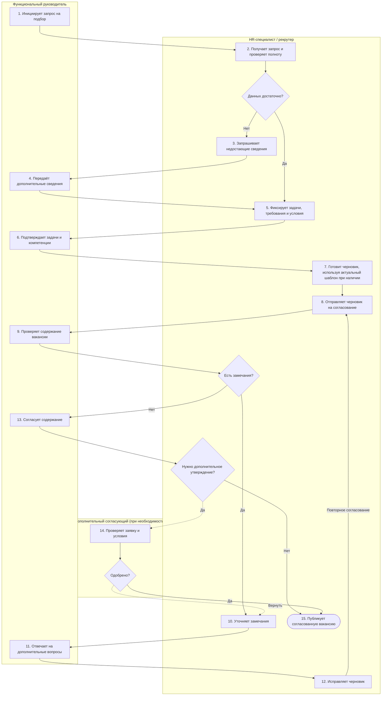

# Анализ процесса AS-IS: формирование и согласование IT-вакансии

**Проект:** AI Job Reality Check

**Основа модели.** Рассмотрен типовой процесс подготовки вакансии в организации с отдельной функцией рекрутинга. Модель составлена по описаниям процессов и функциям существующих HR-систем Workable, Greenhouse и Хантфлоу, методике OPM и материалам первого этапа проекта. Она не является результатом обследования определённого работодателя; внутренние показатели компании в работе не используются. В AS-IS нет предлагаемого AI-решения.

## Границы процесса

| Параметр | Описание |
|---|---|
| Назначение | Подготовить, согласовать и опубликовать вакансию для начала подбора IT-специалиста. |
| Начало | Руководитель инициирует потребность в найме и направляет запрос HR. |
| Завершение | Опубликована согласованная вакансия. |
| Основные участники | Функциональный (нанимающий) руководитель и HR-специалист/рекрутер. |
| Дополнительный участник | Согласующий по бюджету или штатной позиции — только если внутренний регламент предусматривает отдельное одобрение. |
| Вход | Запрос на подбор, задачи роли, требования к компетенциям, условия работы, при наличии — шаблон или предыдущая вакансия. |
| Выход | Утверждённый текст вакансии и запись о публикации. |
| Вне границ | Оценка кандидатов, интервью, оффер, оформление трудоустройства и адаптация. Эти этапы рассматриваются лишь в связи с возможными последствиями неточного описания роли. |

Заявка на подбор (*job requisition*) и опубликованное объявление (*job posting*) — разные документы. Согласование бюджета или разрешения на найм само по себе не означает проверки полноты обязанностей и технических требований [S4], [S7].

## Диаграмма процесса

Основная схема построена с дорожками по ролям: функциональный руководитель, HR-специалист и дополнительный согласующий. Три решения определяют дальнейший маршрут: достаточность первоначальных данных, наличие замечаний к тексту, необходимость дополнительного утверждения. Отказ дополнительного согласующего также ведёт к возврату на уточнение.



**Пояснение.** Шаг 6 отвечает за подтверждение задач до создания объявления; шаг 13 — за утверждение окончательного текста. Шаг 14 не обязателен во всех организациях. Он показан после содержательного согласования; в других существующих процессах разрешение на подбор оформляется раньше, на этапе заявки [S9]. Редактируемая схема Draw.io предоставлена отдельным файлом и соответствует данной последовательности.

## Шаги процесса

В таблице кратность отражает структуру сценария («на заявку», «при замечаниях»), а не частоту, установленную наблюдением. Длительность операций для обобщённой модели не задаётся.

| № | Исполнитель и действие | Вход | Выход | Возможная система / инструмент | Время | Частота |
|---|---|---|---|---|---|---|
| 1 | Руководитель инициирует запрос | Потребность в сотруднике | Запрос на подбор | Форма, почта, ATS | — | На новую позицию |
| 2 | HR проверяет полноту запроса | Запрос руководителя | Перечень полученных данных и пробелов | ATS, форма, переписка | — | На запрос |
| 3 | HR запрашивает недостающие сведения | Незаполненные поля или вопросы | Запрос уточнений | Встреча intake, почта | — | Если сведений недостаточно |
| 4 | Руководитель дополняет сведения | Вопросы HR | Уточнённые задачи, условия и требования | Встреча, форма, письмо | — | По запросу HR |
| 5 | HR структурирует информацию о роли | Первоначальный и дополненный запрос | Перечень задач, обязательных и желательных компетенций, условий | Документ, ATS | — | На заявку |
| 6 | Руководитель подтверждает профиль роли | Структурированный профиль | Согласованные задачи и компетенции | Документ, встреча | — | На подготовленный профиль |
| 7 | HR подготавливает черновик вакансии | Подтверждённый профиль и, при наличии, шаблон | Черновик текста | Редактор, ATS | — | На черновик / новую версию |
| 8 | HR направляет черновик на согласование | Черновик вакансии | Текст на проверке | Почта, ATS, документ | — | На каждую версию |
| 9 | Руководитель проверяет содержание | Текст вакансии | Замечания или согласие | Комментарии, ATS | — | На каждую версию |
| 10 | HR уточняет замечания | Замечания к черновику | Конкретные вопросы | Встреча, переписка | — | При замечаниях |
| 11 | Руководитель отвечает на вопросы | Вопросы HR | Уточнённые требования | Встреча, переписка | — | При необходимости |
| 12 | HR исправляет и повторно отправляет | Уточнённые требования | Новая версия черновика | Редактор, история версий | — | При возврате |
| 13 | Руководитель утверждает содержание | Итоговый черновик | Содержательное согласование | Документ, ATS | — | На итоговую версию |
| 14 | Дополнительный согласующий рассматривает заявку/условия | Запрос на открытие позиции / условия | Одобрение или возврат | Система согласований | — | Если предусмотрено регламентом |
| 15 | HR публикует вакансию | Согласованный текст и необходимые разрешения | Опубликованная вакансия | ATS, карьерный сайт, job board | — | На утверждённую вакансию |

Основные промежуточные документы — заявка на подбор, ответы на уточнения, профиль роли, черновик вакансии, комментарии и версии текста, подтверждения согласования. Для записи информации могут применяться ATS, корпоративные формы, текстовые документы и переписка. Использование прежнего шаблона само по себе не является недостатком: риск создаёт перенос неактуальных требований без пересмотра [S6], [S8].

### Варианты прохождения процесса

- **Исходных данных достаточно.** После шага 2 процесс сразу переходит к структурированию профиля (шаг 5), без дополнительных вопросов на шагах 3–4.
- **Есть замечания.** После проверки руководителем выполняются уточнение, ответ и переработка текста (шаги 10–12), затем повторяется шаг 8.
- **Дополнительное утверждение не требуется.** После содержательного согласования (шаг 13) HR публикует вакансию (шаг 15).
- **Дополнительное утверждение предусмотрено.** Заявка проходит шаг 14. При возврате HR организует уточнение; при одобрении публикует объявление. Некоторые ATS организуют это согласование ещё до передачи заявки рекрутеру [S9], [S10].

## Источники данных

Порядок основных операций составлен на основе документов поставщиков ATS и профессиональных методик, в которых описаны intake-встречи, формирование требований, подготовка вакансии и согласование. Отдельная группа публикаций используется только для характеристики последствий неточного найма и общего масштаба рекрутинга.

### Описания существующих процессов и инструментов

| Код | Источник / что непосредственно подтверждает | Тип и ограничение |
|---|---|---|
| S1 | [Workable: hiring manager–recruiter intake meeting](https://resources.workable.com/hiring-manager-intake-meeting-questions): сбор задач, критериев, обязанностей, различение must-have/nice-to-have, подготовка вакансии | Практическая методика, **не** замер частот или длительностей |
| S2 | [LinkedIn: Connecting hiring managers and recruiters](https://business.linkedin.com/hire/resources/talent-strategy/recruiter-hiring-manager-relationships): повестка intake, задачи, квалификации, формализация ожиданий, дальнейшая координация | Руководство по практике |
| S3 | [Greenhouse: Job kickoff form setup, 02.03.2026](https://support.greenhouse.io/hc/en-us/articles/4416516361499-Job-kickoff-form-setup): рекрутер отправляет форму, руководитель отвечает, ответы проверяются, после чего переходят к публикации | **Реально описанная функция продукта**, а не обычай каждой компании |
| S4 | [Workable: job vs requisition](https://help.workable.com/hc/en-us/articles/7291057591959-What-is-the-difference-between-a-job-and-a-requisition): различие внутреннего запроса и опубликованной вакансии; возможность approval | Документация продукта |
| S5 | [US OPM: Six Steps to Conducting a Job Analysis](https://www.opm.gov/policy-data-oversight/assessment-and-selection/job-analysis/job_analysis_checklist.pdf): документы о задачах, экспертная оценка критичности задач/компетенций | Методика государственного HR в США; **не универсальная обязанность IT-компаний** |
| S6 | [Greenhouse: Create a new job, 24.06.2026](https://support.greenhouse.io/hc/en-us/articles/200668380-Create-a-new-job): можно копировать существующую вакансию, взять образец либо создать с нуля; предусмотрен запрос approval | Функциональность ATS; не свидетельство, что шаблоны не актуализируют |
| S7 | [Greenhouse: Types of approvals](https://support.greenhouse.io/hc/en-us/articles/201087714-Types-of-approvals): отдельные согласования для открытия позиции, для оффера и др. | Поясняет различие формального утверждения и содержательного ревью |
| S8 | [Хантфлоу: Как отправить заявку на вакансию](https://huntflow.ru/help/knowledge-base/application-new/): заявку заполняет заказчик, возможна подстановка текста прошлой заявки; поставщик описывает риски устной передачи и потерянных заявок | Документация российской ATS плюс пояснения поставщика; не статистическое измерение распространённости этих рисков |
| S9 | [Хантфлоу: Как согласовать заявку на вакансию](https://huntflow.ru/help/knowledge-base/agreement/): согласующие получают запрос по почте; при отклонении заявка возвращается автору; согласование может предшествовать поступлению заявки в HR | **Реальное документированное ветвление** в российской ATS; это approval **заявки**, а не доказательство проверки полноты текста вакансии |
| S10 | [Хантфлоу: Как настроить заявку под ваш бизнес-процесс](https://huntflow.ru/help/knowledge-base/customize-the-vacancy-request/): поддерживаются редактируемые поля, несколько форм и необязательность/обязательность предварительного approval | Подтверждает, что разные организации могут использовать разные схемы без единой универсальной последовательности |

### Исследования и рыночный контекст

| Код | Подтверждённые данные | Что это **не** доказывает |
|---|---|---|
| E1 | [hh.ru через Коммерсантъ, 05.12.2025](https://www.kommersant.ru/doc/8252234): 67% опрошенных рекрутеров отмечают несоответствие задач ожиданиям как причину отказа новичка в период испытания; 90% принятых прошли испытание согласно публикации | **Не означает**, что 67% работников увольняются из-за текста вакансии; не измеряет качество описаний |
| E2 | [CIPD / Omni RMS, 25.09.2024](https://www.cipd.org/uk/about/news/cipd-omni-rms-recruitment-retention-report-2024/): 41% опрошенных работодателей сталкивались с ранним уходом новичков в течение первых 12 недель | Не означает, что 41% нанятых ушли; не связывает уход с описанием вакансии |
| E3 | [CIPD Resourcing and Talent Planning 2026, 22.09.2026](https://www.cipd.org/uk/knowledge/reports/resourcing-surveys/): 46% организаций сообщают о ситуативном (ad hoc) подходе к рекрутингу; 31% отслеживают time-to-hire | Данные работодателей Великобритании о зрелости рекрутинга, не о конкретных 15 шагах/нашей компании |
| E4 | [QIC-WD: Realistic Job Previews, обзор исследований](https://www.qic-wd.org/node/437): реалистичная информация помогает ясности роли и восприятию честности; влияние на удержание скромное, возможна потеря привлекательности | Обзор RJP не доказывает эффективность алгоритмической проверки вакансий |
| E5 | [SHRM: Recruiting Executives Benchmarking 2026](https://www.shrm.org/topics-tools/research/recruiting-benchmarking): **39 календарных дней**, медиана time-to-fill неруководящих должностей в выборке SHRM (США, 2026; более 4600 организаций) | Включает **весь цикл от заявки на открытие позиции до принятия оффера**; не равно M5 «от запроса до утверждения текста», не является бенчмарком IT и не показывает среднее время работы HR над вакансией |
| E6 | [SHRM: 2025 Benchmarking Survey, пресс-релиз](https://www.shrm.org/about/press-room/shrm-releases-2025-benchmarking-reports--how-does-your-organizat): **$5 475** — средний cost-per-hire неруководящей позиции, **$35 879** — руководящей, по ответам участников опроса SHRM в США | Средняя стоимость всего рекрутинга (внутренние и внешние затраты), **не стоимость одного возврата на редактирование**; нельзя подставлять в формулу потерь от согласований |
| E7 | [SHRM: 2025 Benchmarking Survey, пресс-релиз](https://www.shrm.org/about/press-room/shrm-releases-2025-benchmarking-reports--how-does-your-organizat): **20% организаций** в выборке сообщили об измерении quality of hire | Контекст ограниченной распространённости оценки качества найма в опросе SHRM; не показывает, сколько организаций контролируют текст вакансии |

Внешние показатели длительности найма (*time-to-fill*), стоимости найма (*cost-per-hire*) и удержания персонала не подставляются в процессные показатели подготовки вакансии: они охватывают более длинный цикл и иные выборки. Например, медиана time-to-fill SHRM в 39 дней не равна времени согласования текста вакансии.

## Обнаруженные проблемы

В модели выделены **потенциальные проблемные участки процесса**. Это аналитические риски для описанного сценария, а не результаты измерения в одной организации.

| Код | Участок | Категория | Потенциальное влияние |
|---|---|---|---|
| P1 | Шаги 1–6: часть задач и ограничений роли остаётся в знаниях руководителя и не входит в профиль | Невидимое знание | Неполный перечень требований в черновике |
| P2 | Шаг 7: прежний текст используют без актуализации под новую позицию | Дублирование / устаревший артефакт | Лишние либо устаревшие требования |
| P3 | Шаги 8–13: проверка формулировок не охватывает фактическую полноту задач | Недостаточная содержательная проверка | Согласованный текст может содержать пробелы |
| P4 | Шаги 3–4 и 10–12: дополнительные обращения и возвраты | Ожидание / повторная обработка | Увеличение длительности и трудозатрат до публикации |
| P5 | Шаги 13–14: согласование разрешения на найм трактуют как подтверждение содержания вакансии | Смешение административного и содержательного контроля | Пропуск содержательных ошибок |
| P6 | После публикации: обязанности и ожидания кандидата расходятся | Последствие за пределами AS-IS | Неудовлетворённость, возможный ранний уход |

В качестве возможных обходных путей в рассматриваемом сценарии выступают устные уточнения без фиксации, копирование текста без актуализации и публикация без предусмотренного согласования. Такие действия относятся к рискам процесса; наличие данных операций не подразумевается для всех организаций.

## Оценка потерь

Оценка разделяет **трудозатраты** (человеко-часы) и **ожидание** (вакансия-дни). Эти показатели нельзя складывать в одну величину. Денежная стоимость рассчитывается отдельно при наличии ставок участников процесса.

```text
Дополнительные циклы = число заявок × доля заявок с возвратом × среднее число повторных циклов
Трудозатраты, чел.-ч = дополнительные циклы × (время HR + время руководителя на цикл)
Ожидание, вакансия-дни = дополнительные циклы × среднее ожидание ответа в рабочих днях
Денежные затраты = дополнительные циклы × (часы HR × часовая ставка HR + часы руководителя × ставка руководителя)
```

**Иллюстративный расчёт для учебной модели** (не статистика работодателя): 12 заявок за месяц; 25% проходят один дополнительный цикл; на один цикл HR затрачивает 1,5 часа, руководитель — 0,5 часа; среднее ожидание ответа — один рабочий день. Получается три дополнительных цикла, шесть человеко-часов дополнительной работы и три вакансия-дня суммарного ожидания. Время ожидания не является дополнительными человеко-часами и не прибавляется к шести часам работы.

### Метрики процесса и последствий

| Код | Метрика и метод расчёта | Где применяется | Базовое значение |
|---|---|---|---|
| M1 | Доля вакансий с существенным расхождением: вакансии с расхождением / проверенные × 100% | Качество описания; экспертная сверка с согласованным перечнем задач | — |
| M5 | Рабочие дни от первоначального запроса до содержательного утверждения (шаг 13) | Длительность подготовки и согласования текста | — |
| M6 | Число повторных циклов согласования на вакансию | Затраты на возвраты, шаги 8–12 | — |
| M2 | Доля ранних уходов из-за несовпадения ожиданий | После найма, вне границ AS-IS | — |
| M3 | Доля повторно открытых позиций в пределах 3–6 месяцев по причине замены сотрудника | После найма, вне границ AS-IS | — |
| M4 | Доля сотрудников, не прошедших испытание | После найма, вне границ AS-IS | — |
| M7 | Candidate NPS: доля оценок 9–10 минус доля оценок 0–6 | Опыт кандидатов после публикации | — |
| M8 | Доля откликов, соответствующих квалификационным требованиям | Эффективность опубликованной вакансии | — |

Прочерк в графе «Базовое значение» означает отсутствие внутренних измерений в рамках исследовательской модели. M1 — целевой показатель качества вакансии; M5 и M6 характеризуют участок AS-IS. Показатели M2–M4, M7 и M8 относятся к более поздним этапам подбора и адаптации. Их значения не смешиваются с результатами процесса подготовки вакансии.

## Связь с проблематизацией и переход к TO-BE

| Противоречие / ограничение | Участок AS-IS | Значение для следующего этапа |
|---|---|---|
| Скорость подготовки и полнота требований | 2–7, 8–13; P1, P3, P4 | Структурированные ответы руководителя и сохранение согласованных требований |
| Повторное использование шаблонов и актуальность текста | 7; P2 | Отдельная актуализация задач и обязательного технологического стека |
| Согласование содержания и разрешение на найм | 13–14; P5 | Раздельные контрольные решения |
| Реалистичность описания и привлекательность вакансии | Публикация и дальнейший найм; P6 | Контроль содержательной достоверности, без автоматического найма |

Для TO-BE исходными артефактами служат перечень подтверждённых руководителем задач и требований, текст вакансии, история правок и решения о согласовании. Наряду с автоматизированным вариантом имеет смысл рассматривать организационную альтернативу: обязательную intake-встречу, чек-лист задач и ручную сверку. Окончательное утверждение текста остаётся за человеком.

**Вывод.** Наиболее значимыми для AI Job Reality Check являются этапы сбора, структурирования и содержательной проверки требований (2–13). Именно на этих шагах могут возникать неполные описания и дополнительные циклы редактирования. Схема AS-IS фиксирует последовательность действий, роли и альтернативные маршруты; дальнейший проект TO-BE использует те же входные данные, роли и контрольные точки.
