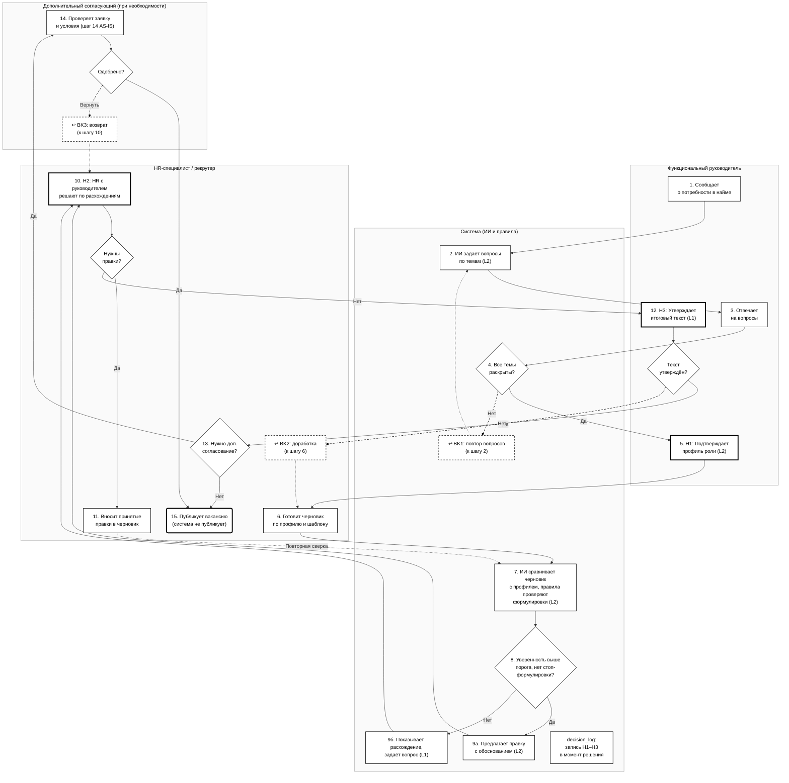
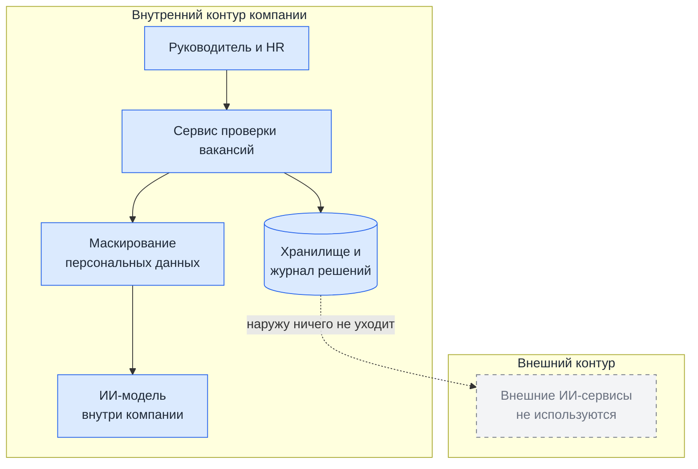

# Целевой процесс и архитектура решения

> **Статус.** Это концепт: системы и данных реальной компании у команды нет. Всё, что не следует из [01_problem.md](01_problem.md) и итоговой версии [02_asis_analysis.md](02_asis_analysis.md) (15 шагов), это предложения команды, требующие проверки. Пороги и числовые значения сроков определим на кейсе.

Коды метрик M1–M6 как в `02_asis_analysis.md`. По регулированию опираемся на EU AI Act: это зарубежное регулирование (ЕС), а не российский рынок.

## Целевой процесс

Что меняется по сравнению с AS-IS (15 шагов): шаги 2–5 (проверка полноты, запрос и структурирование сведений) заменяются вопросами ИИ по темам. Профиль роли подтверждает руководитель (шаг 6), черновик готовит HR (шаг 7), затем система сверяет его с профилем. Вместо цепочки замечаний и возвратов (шаги 8–11) HR с руководителем решают по найденным расхождениям, а принятые правки вносит HR, как в AS-IS (шаг 12). Утверждение (шаг 13), дополнительное согласование, если оно предусмотрено (шаг 14), и публикация (шаг 15) остаются у людей и работают как в AS-IS.

### Границы процесса

- **Начало:** руководитель сообщает о потребности в найме (шаг 1).
- **Конец:** HR публикует вакансию после утверждения текста человеком (шаг 15).
- **Вне процесса:** отбор и оценка кандидатов, решения о найме, адаптация нового сотрудника.

### Диаграмма процесса



Цифры показывают порядок шагов и совпадают с колонкой «№» в таблице ниже. Жирная рамка у `H1`–`H3` и у публикации (`PUB`) показывает точки решения человека. Пунктирные блоки с «↩» (`BK1`–`BK3`) показывают возврат, а пунктирные стрелки от них ведут обратно к шагу 2 (`INT`), шагу 6 (`DRAFT`) и шагу 10 (`H2`). Пунктирная стрелка от шага 11 (`FIX`) ведёт к шагу 7 (`CMP`): исправленный текст сверяется повторно. Каждое решение `H1`–`H3` записывается в `decision_log` в момент принятия, в том числе отказ и возврат на доработку. Редактируемая схема Draw.io предоставлена отдельным файлом (`03_tobe_process.drawio`) и соответствует данной последовательности: дорожки по ролям, те же номера шагов, обозначения и возвраты.

### Шаги процесса

| № | ID | Кто | Что происходит | Уровень | Шаг AS-IS |
|---|---|---|---|---|---|
| 1 | `REQ` | Руководитель | Сообщает о потребности в найме | L0 | 1 |
| 2 | `INT` | Система | ИИ задаёт вопросы по темам (задачи, стек, нагрузка, процессы, команда). Число раундов уточнений ограничено | L2 | вместо 2–3 |
| 3 | `ANS` | Руководитель | Отвечает своими словами, может ответить «не знаю» | L0 | вместо 4 |
| 4 | `RUL` | Система | ИИ собирает профиль роли из ответов, правило проверяет, все ли обязательные темы раскрыты. Да: к `H1`. Нет: к `BK1` | L2 и правило | вместо 5 |
| ↩ | `BK1` | Система | Возврат к шагу 2 (`INT`): ИИ задаёт уточняющие вопросы по нераскрытым темам | L2 | новый |
| 5 | `H1` | Руководитель | Подтверждает или правит профиль роли. Решение записывается в журнал | L2 | 6 |
| 6 | `DRAFT` | HR | Готовит черновик вакансии по профилю (при наличии, по шаблону) | L0 | 7 |
| 7 | `CMP` | Система | ИИ сравнивает черновик с подтверждённым профилем, правила ищут стоп-формулировки | L2 | новый |
| 8 | `CONF` | Система | Уверенность выше порога и нет стоп-формулировки? Да: к `SUG`. Нет, или найдена формулировка риска: к `SUM` | правило | новый |
| 9а | `SUG` | Система | Предлагает сохранить, изменить или удалить требование, с обоснованием | L2 | новый |
| 9б | `SUM` | Система | Показывает расхождение и задаёт руководителю уточняющий вопрос. Если при повторной сверке расхождений нет, сообщает об этом, и `H2` подтверждает текст без правок | L1 | новый |
| 10 | `H2` | HR и руководитель | Руководитель отвечает на вопрос системы, затем HR с руководителем принимают или отклоняют каждое предложение. Решение записывается в журнал. Дальше переход к `DF` | L2 или L1 | вместо 8–11 |
| – | `DF` | HR и руководитель | Развилка «Нужны правки?». Да: к `FIX`. Нет: к `H3` | действие человека | развилка перед 12 |
| 11 | `FIX` | HR | Вносит принятые правки в черновик (как «Исправляет черновик» в AS-IS). Дальше возврат к шагу 7 (`CMP`): ИИ сверяет новую версию, потому что правка могла добавить новое расхождение. Шаги 7–10 повторяются, пока в `DF` не будет «Нет» | L0 | 12 |
| 12 | `H3` | Руководитель | Утверждает итоговый текст (версию, прошедшую сверку). Решение записывается в журнал. Дальше переход к `DT` | L1 | 13 |
| – | `DT` | Руководитель | Развилка «Текст утверждён?». Да: к `ADDQ`. Нет: к `BK2` | L1 | развилка после 13 |
| ↩ | `BK2` | HR | Возврат к шагу 6 (`DRAFT`): HR дорабатывает черновик, дальше повторяются шаги 7–10 | L0 | 10–12 |
| 13 | `ADDQ` | HR | Нужно ли дополнительное согласование, как в AS-IS? Да: к `ADD`. Нет: к `PUB` | правило | развилка перед 14 |
| 14 | `ADD` | Доп. согласующий | Проверяет заявку и условия, если дополнительное согласование предусмотрено. Без изменений. Дальше переход к `DA` | действие человека | 14 |
| – | `DA` | Доп. согласующий | Развилка «Одобрено?». Да: к `PUB`. Вернуть: к `BK3` | действие человека | развилка после 14 |
| ↩ | `BK3` | Доп. согласующий | Возврат к шагу 10 (`H2`): доработка по замечаниям | L0 | 14, возврат |
| 15 | `PUB` | HR | Публикует вакансию. Система не публикует | действие человека | 15 |
| – | `LOG` | Система | Записывает каждое решение `H1`, `H2`, `H3` в момент принятия, включая отказы и возвраты, и вывод системы | L3 | новый |

Дополнительное согласование (шаг 14 AS-IS) остаётся как есть: система его не заменяет. На схеме оно в отдельной колонке, потому что в части организаций его нет. Решений о людях в контуре нет: система не оценивает кандидатов и не принимает решений о найме (см. границы в `01_problem.md`).

**Какие проблемы AS-IS закрываются.** P1 (невидимое знание): `INT`, `RUL`, `H1`. P2 и P3 (старый текст, проверка без полноты): `CMP`, `CONF` и решение в `H2`. P4 (возвраты и ожидание): вопросы сразу по темам и общее решение в `H2`, ожидаем меньше циклов (гипотеза, метрика M6). P5 (разрешение на найм вместо проверки содержания): содержание утверждает руководитель в `H3`, шаг 14 остаётся отдельно. P6 (после публикации): вне контура, только читаем данные для метрик M2–M4.

### Связь с проблематизацией и AS-IS

| Противоречие или ограничение (раздел «Связь с проблематизацией» в `02_asis_analysis.md`) | Что в TO-BE | Оператор разрешения (гипотеза команды) | Как проверяем |
|---|---|---|---|
| Скорость подготовки и полнота требований (P1, P3, P4) | ИИ задаёт вопросы по темам, руководитель отвечает и подтверждает профиль роли (`INT`, `ANS`, `RUL`, `H1`) | Посредник: ИИ стоит между руководителем и текстом. Структура: профиль роли становится отдельным подтверждённым документом. Условие: вопросы только по нераскрытым темам | M1, M5, M6 |
| Повторное использование шаблонов и актуальность текста (P2) | Черновик сверяется с подтверждённым профилем, лишние и пропущенные требования видны (`CMP`, `CONF`, `SUG`, `SUM`) | Смена уровня: проверяем требования, а не формулировки | M1 |
| Согласование содержания и разрешение на найм (P5) | Содержание утверждает руководитель (`H3`), разрешение на найм остаётся отдельным шагом (`ADD`) | Структура: два решения разведены | M1, M5 |
| Реалистичность описания и привлекательность вакансии (P6) | Система правит только факты, тон остаётся за HR, отбор кандидатов вне контура | Система не решает это противоречие. Вариант «время» (реалистичная информация после оффера) вне объёма | M2–M4 только читаем, воронку откликов наблюдаем |

Инверсию (ИИ сам пишет текст вакансии) мы отвергли, см. «Обоснование альтернатив». Операторы «время», «пространство» и «синтез» для первого противоречия не использовали.

### Новое противоречие после внедрения

Это гипотезы, которые проверим в пилоте (см. «План проверки»).

- **Полнота проверки и нагрузка на руководителя.** Чем больше тем и вопросов, тем полнее профиль роли, но тем дольше отвечает руководитель. Ограничение из `01_problem.md`: время до утверждения (M5) не должно существенно вырасти. Повторная сверка после правок (шаг 7) добавляет круги, поэтому следим за M5 и M6. Сигналы: рост M5 и M6, рост доли ответов «не знаю». Меры: число раундов ограничено, вопросы только по нераскрытым темам, при ухудшении ИИ-часть для роли отключается.
- **Честность описания и привлекательность вакансии** (связанное противоречие из `01_problem.md`). Исправление фактов может снизить число откликов. Сигнал: падение воронки откликов (допущение 5). Мера: тон остаётся за HR, реалистичную информацию можно перенести на этап после оффера.

## Обоснование альтернатив

| Вариант | Описание | Почему не выбран | Почему выбран |
|---|---|---|---|
| Приказ «писать вакансии подробнее» | Административная мера | Не даёт руководителю времени, а HR экспертизы (см. `01_problem.md`) | — |
| ИИ пишет текст вакансии | ИИ вместо руководителя | Не знает реальной работы команды, пишет гладкий общий текст | — |
| Только обычные правила | Чек-лист, список запрещённых формулировок | Проверяют форму, но не смысл | Остаются как проверка тем и формулировок |
| Организационный вариант без ИИ | Обязательная intake-встреча, типовая форма и чек-лист задач, ручная сверка текста с чек-листом | Может улучшить процесс и сам по себе, поэтому остаётся базой для сравнения. Но заполнить форму можно формально, а ручная сверка на каждой версии добавляет операции (мнение команды, не измерено) и может ухудшить время до утверждения (M5) | Частично: структурированный сбор требований (обязательные темы интервью) и обязательное утверждение человеком остаются и в нашем варианте |
| **ИИ-интервью, сверка, правила, решает человек** | Гибрид, основной кандидат для TO-BE | — | Время руководителя уходит на ответы, а не на написание текста, а достоверность проверяется сверкой |

Организационный вариант не отбрасываем: на кейсе сравниваем с ним гибридный вариант по M1, M5 и M6 (см. `01_problem.md` и `02_asis_analysis.md`).

**Почему здесь нужен ИИ, а не обычное правило.** Правило проверяет форму: заполнено ли поле, есть ли запрещённое слово. ИИ нужен, чтобы вести разговор со свободными ответами и сравнивать смысл текста вакансии с этими ответами, когда одно и то же сказано разными словами. Где хватает правила, используем правило.

## Архитектура решения

| Компонент | Назначение | Ответственность |
|---|---|---|
| Интерфейс руководителя | Вопросы интервью, подтверждение (`H1`, `H3`) | Руководитель отвечает за ответы, команда продукта за интерфейс |
| Интерфейс HR | Показ расхождений, решения (`H2`), публикация | HR отвечает за решения, команда продукта за интерфейс |
| Сервис сценария | Ведёт шаги, ограничивает раунды уточнений, блокирует публикацию до `H1`–`H3` | Команда продукта |
| Модуль правил | Проверка обязательных тем и стоп-формулировок | HR отвечает за список, команда продукта за работу |
| ИИ-модуль | Вопросы, сбор требований, сравнение, обоснование | Команда продукта |
| Предобработка | Маскирует персональные данные (ФИО, контакты) | ИТ компании |
| Хранилище | Версии вакансий, ответы интервью, результаты сравнения | ИТ компании |
| Журнал решений | Записи `H1`–`H3` и вывода системы | ИТ компании |

## Границы контура данных



| Данные | Где хранится | Что уходит наружу | Чем защищено |
|---|---|---|---|
| Ответы руководителя | Внутреннее хранилище | Ничего | Доступ по ролям, маскирование персональных данных |
| Версии вакансии и результаты сравнения | Внутреннее хранилище | Ничего (публикует человек) | Доступ по ролям, история версий |
| Журнал решений | Внутреннее хранилище | Ничего | Записи только добавляются |
| Данные для метрик M2–M4 (журнал вакансий, кадровый учёт) | Читаются, не копируются | Ничего | Только суммарные значения, без фамилий |

**Всё остаётся во внутреннем контуре, наружу ничего не уходит.** Цена этого решения: нужна ИИ-модель внутри компании, её качество не проверялось. Вариант с внешней моделью не выбран: в вакансиях встречаются внутренние системы, а в ответах могут быть фамилии коллег.

## Human-in-the-Loop

### Уровни автоматизации

| Уровень | Что делает система | Где применять |
|---|---|---|
| L0 | человек делает всё, система хранит | Запрос, черновик, ответы руководителя, версии |
| L1 | система готовит сводку, человек решает | Расхождение без правки, формулировка риска, утверждение (`H3`), публикация |
| L2 | система предлагает с обоснованием, человек подтверждает | Сбор требований (`H1`), предложения правок (`H2`) |
| L3 | система действует сама ниже порога риска | Служебное: сохранение версий, напоминания, запись в журнал |
| L4 | система действует без участия человека | Не применяется |

Правило выбора: уровень определяется ценой ошибки, а не возможностями модели. Для необратимых решений (увольнение, отказ в найме, отказ в повышении) уровень не выше L1: таких решений в нашем контуре нет. Правка текста вакансии обратима до публикации, поэтому L2. Публикацию держим на L1 и только у человека: текст можно исправить, но кандидаты уже могли его прочитать.

### Точки вмешательства

| ID | Точка решения | Уровень | Условие срабатывания | Право на отказ | Срок | Эскалация | Куда попадает лог |
|---|---|---|---|---|---|---|---|
| H1 | Руководитель подтверждает профиль роли | L2 | Всегда после интервью | да, с причиной | Не дольше, чем сейчас занимают уточнение сведений и подтверждение профиля в AS-IS (шаги 3–4 и 6, время не измерено) | Напоминание (L3), затем руководитель HR. Публикация заблокирована до ответа | `decision_log`, запись в момент решения, в том числе при отказе |
| H2 | HR и руководитель решают по расхождениям | L2, для формулировок риска L1 | Найдено расхождение или формулировка из списка | да, с причиной | Не дольше, чем сейчас занимают проверка и уточнение замечаний в AS-IS (шаги 9–11, время не измерено) | Напоминание (L3), затем руководитель HR. Публикация заблокирована до решения | `decision_log`, запись в момент решения, в том числе при отказе |
| H3 | Руководитель утверждает итоговый текст | L1 | Всегда перед публикацией, после `H1` и `H2` | да, с причиной | Не дольше, чем сейчас занимает утверждение в AS-IS (шаг 13, время не измерено) | Напоминание (L3), затем руководитель HR. Публикация заблокирована до решения | `decision_log`, запись в момент решения, в том числе при отказе |

Руководитель HR это заказчик проекта. Числовые значения сроков зададим после замера времени шагов в `02_asis_analysis.md`, пока замера нет, срок задан правилом.

### Объяснимость

Система не просто говорит «убрать» или «исправить»: она показывает, что заметила, на чём основан вывод и что стоит перепроверить. Так человеку не нужно верить ей на слово.

Реальной системы пока нет, поэтому пример ниже иллюстрация, данные в нём вымышленные.

**Пример. Система показывает расхождение и уточняет у руководителя (L1, затем L2), вакансия «Backend-разработчик».**

```
Пример решения: показать расхождение и предложить руководителю уточнить, нужен ли
  «свободный английский». После его ответа предложить сохранить, изменить или
  удалить требование (L2). Решение остаётся за человеком.
Повлиявшие признаки: в черновике требование есть, а в профиле роли, который
  подтвердил руководитель, его нет: про работу с иностранными коллегами
  и документацию на английском в ответах ничего не сказано.
  Направление влияния: в сторону проверки требования, а не его удаления.
Использованные данные: черновик вакансии (версия 2), профиль роли по ответам
  руководителя на вопросы 4 и 7. Их можно открыть и проверить.
Почему не на единицу выше: система не знает, нужен ли английский, руководитель
  мог просто не упомянуть его. Поэтому сначала вопрос (L1), а после ответа
  предложение с обоснованием (L2, а не L3). Оставляет или удаляет требование человек.
Что проверить человеку: действительно ли английский нужен для этой роли и если да,
  то в какой мере (читать документацию или вести переговоры).
```

### Право на отказ и эскалация

| Точка | Может ли человек отклонить | Что происходит при отказе | Что если не ответил |
|---|---|---|---|
| H1 | да | Предложение не применяется, остаётся версия руководителя, отказ и причина сразу пишутся в журнал | Напоминание, затем руководитель HR. Публикация заблокирована |
| H2 | да | Текст остаётся как есть, расхождение помечается «отклонено» с причиной, отказ сразу пишется в журнал | Напоминание, затем руководитель HR. Публикация заблокирована |
| H3 | да | Вакансия возвращается на доработку (`BK2`), возврат и причина сразу пишутся в журнал | Напоминание, затем руководитель HR. Публикация заблокирована |

## Риски ИИ и контрмеры

| Риск | Категория | Сценарий | Контрмера в архитектуре | Уровень контроля | Проверка |
|---|---|---|---|---|---|
| Формулировки с признаками дискриминации остаются в вакансии | справедливость | Шаблон содержит формулировку про возраст или пол, ИИ её не заметил | Список запрещённых формулировок плюс пометка ИИ, решение человека | H2, L1 | Проверка на примерах формулировок с известными нарушениями |
| Предложение без понятного обоснования | прозрачность | Человек принимает правку «на веру» | У каждого предложения есть ссылка на ответ и фрагмент текста, без них предложение не показывается | L2 | Проверка, что у всех предложений есть источник |
| Выдуманное требование или массовая ошибка модели | надёжность | В правке появляется пункт, которого руководитель не называл, или после обновления модели предложения стали хуже | Правки только по подтверждённым на `H1` требованиям, порог уверенности, версия системы в журнале, откат до L1 (только сводка) | H1, L | Проверка на тестовых вакансиях перед каждым обновлением модели |
| Утечка внутренних данных | данные | В ответах названия систем и фамилии | Внутренний контур, маскирование, доступ по ролям | L | Проверка прав доступа и отсутствия внешних запросов |
| Процесс становится дольше | влияние на людей | Интервью и подтверждения удлиняют согласование | Ограничение из `01_problem.md`: время до утверждения (M5) не ухудшается. Если ухудшается, ИИ-часть отключаем | H | Сравнение M5 и M6 до и после |
| Система начинает оценивать людей | право | Появляются профили руководителей или оценка кандидатов, и система попадает в зону высокого риска по EU AI Act | Не делаем: в журнале только ответы по вакансии. Проверяем классификацию при любом расширении функций | L | Сверка функций системы с Annex III, п. 4 EU AI Act (подбор и оценка людей относятся к высокому риску) |
| Неполные или формальные ответы руководителя | качество данных | Руководитель отвечает кратко или «не знаю» по важным темам, а система считает тему раскрытой | Обязательные темы (`RUL`): ответ «не знаю» помечает тему как нераскрытую, и это видно на `H1`. Сравнение только по подтверждённым требованиям | H1 | Доля тем, помеченных как нераскрытые, на кейсе |
| Посторонний доступ к ответам или правка журнала | безопасность | Кто-то читает ответы руководителя или изменяет записи журнала, чтобы скрыть решение | Доступ по ролям, журнал только дополняется, у каждой записи `input_hash`. Круг лиц с доступом определим в требованиях (этап 4) | L | Проверка прав доступа, попытка изменить запись должна заканчиваться отказом |

Применимы все 8 категорий чек-листа: справедливость, прозрачность, данные, надёжность, влияние на людей, право, качество данных, безопасность.

### Классификация по EU AI Act (допущение 7 из `01_problem.md`)

Сверяем функции системы с Annex III, п. 4 (подбор людей и решения о работе). Это наше прочтение, не юридическое заключение.

| Функция | Что делает | Вывод |
|---|---|---|
| Интервью руководителя | Собирает сведения о работе, а не о человеке | Вне п. 4 |
| Сверка текста вакансии с профилем роли | Проверяет текст, людей не оценивает | Вне п. 4 |
| Пометка формулировок с признаками дискриминации | Защитная проверка текста | Вне п. 4 |
| Оценка, фильтрация или ранжирование кандидатов | П. 4(a): высокий риск | Не делаем |
| Профиль руководителя, HR или кандидата | Профилирование людей: всегда высокий риск | Не делаем |
| Вывод эмоций по голосу или лицу | Art. 5(1)(f): запрещено на работе | Не делаем |

Если функции расширятся, классификацию проверяем заново и добавляем требования Art. 9–15 и 26. Принципы Art. 14 (человек может отклонить результат) и Art. 26 (журнал, уведомление участников) учтены в точках `H1`–`H3` и в журнале независимо от классификации. Российские нормы не разбирались: перед внедрением в российской компании их нужно проверить отдельно.

**Принятые сознательно риски:**
- Полностью убрать привычку соглашаться с системой нельзя. Снижаем показом источника и учётом доли принятых предложений.
- Система проверяет, согласуется ли текст с ответами руководителя, а не истину о работе. То, что руководитель сам не осознаёт («невидимое знание», см. `02_asis_analysis.md`), она не выявит.
- Качество зависит от честности ответов руководителя.
- Честное описание может снизить привлекательность вакансии (второе противоречие из `01_problem.md`). Система правит только факты, тон остаётся за HR.
- Допущение, что система вне высокого риска по EU AI Act, не проверено юристом.

## Логирование и аудит

```
decision_id, timestamp, actor_id, system_version, input_hash,
features_used, model_output, confidence, human_action,
override_reason, escalation_state
```

`input_hash` обязателен: без него невозможно доказать, что решение принималось по заявленным данным, и невозможно его оспорить. Здесь это хеш пары «версия черновика и версия ответов интервью». Журнал только дополняется. Срок хранения и круг лиц с доступом определим в требованиях (этап 4). Запись создаётся в момент каждого решения `H1`–`H3`, включая отказы и возвраты на доработку, а не после публикации.

## План проверки (пилот)

Принципы: критерии успеха фиксируем до начала проверки. Начинаем с ручного прогона на учебном кейсе, где человек выполняет роль ИИ, и автоматизируем только то, что помогает. Решение остаётся за человеком. Данные двух видов: реальные с источником и вымышленные с явной пометкой, как в `02_asis_analysis.md`. Организационный вариант (intake-встреча, чек-лист, ручная сверка) служит базой для сравнения.

| Допущение из `01_problem.md` | Проверка | Критерий успеха | Если не подтвердилось |
|---|---|---|---|
| 2. Расхождения значимы | Сравнить 5–10 вакансий кейса с задачами, которые назовут руководители | M1 заметно выше нуля | Проблема не в тексте вакансии, пересматриваем постановку |
| 3. Интервью повышает полноту требований | Прогнать ручной вариант и вариант с ИИ на одних вакансиях, оценить по заранее заданному списку критериев | M1 ниже, M5 и M6 не хуже, чем в организационном варианте | Оставляем организационный вариант |
| 4. ИИ находит пропуски | Тест на вакансиях с заранее известными расхождениями | Доля найденных расхождений и доля ложных предупреждений (пороги задаём до теста) | Оставляем структурированный опросник без ИИ-сверки (L0 и L1) |
| 5. Честность не роняет отклики | Наблюдать воронку откликов, если данные доступны | Воронка не падает | Тон остаётся за HR, реалистичная информация после оффера |
| Ограничение: время не растёт | Сравнить M5 и M6 до и после | M5 не хуже, M6 не выше | ИИ-часть для роли отключаем |

## Условия применимости

Это гипотезы, проверим на кейсе.

- **Подходит:** IT-вакансии, где HR оформляет вакансию, а требования знает функциональный руководитель. Поток вакансий достаточен, чтобы интервью окупалось (порог не задан). Руководитель готов отвечать на вопросы. Данные и ИИ-модель можно держать внутри компании.
- **Мало пользы:** единичные вакансии. Требования уже собираются в структурированной заявке и проверяются. В согласовании нет HR-звена.
- **Что потребуется (стоимость не оценивали):** интерфейсы для руководителя и HR, ИИ-модель внутри контура, поддержка списка стоп-формулировок, время руководителя на интервью.

## Что не определено

- Порог уверенности, число раундов уточнений, числовые значения сроков `H1`–`H3` (зададим после замера времени шагов в AS-IS, пока срок задан правилом).
- Срок хранения журнала и круг лиц с доступом (этап 4).
- Базовые значения метрик (кейса нет), ИИ-модель внутри контура и её качество.
- Классификация по EU AI Act: это не юридическое заключение, российские нормы не разбирались.

Методические указания: раздел «Методика → Целевой процесс и контур Human-in-the-Loop» в репозитории `hrtech-practice`.
